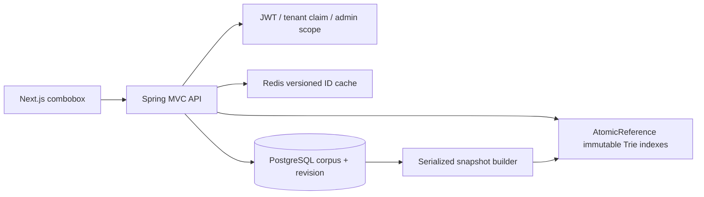
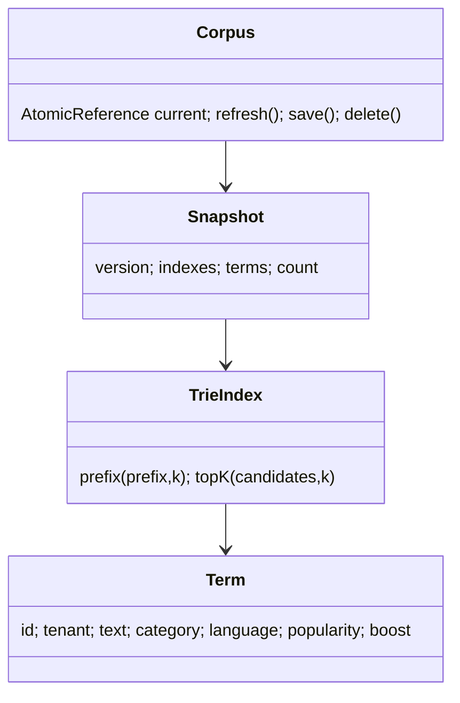

> Baseline architecture context: the updated snapshot, ranking, security, analytics and administration contracts in [workflows.md](workflows.md) supersede older implementation-status statements below.

# Architecture and acceptance boundaries

The core package depends only on Java. Spring adapters own storage, security, scheduling, and transport. PostgreSQL is authoritative. Public requests resolve only the public tenant; JWT requests require a validated tenant claim. All currently supported terms are tenant-public. Private per-user ACLs are unsupported and must not be imported.

NFKC normalization followed by ROOT lowercasing, strip, and Java whitespace collapse defines nfkc-root-v1. This is NOT full Unicode case folding, Turkish locale casing, accent folding, transliteration, or confusable-script detection. Punctuation and accents remain significant. Display text is preserved. Highlights use UTF-16 offsets and include following non-spacing marks. Grapheme clusters and whitespace expansion need broader property tests before production.

Each index stores the best 20 unique normalized display terms at each prefix node. Category/language-specific indexes avoid filtering a globally truncated list. Memory costs can be substantial: up to four context indexes per term, and O(nodes * K) references. Prefix navigation is O(p); retrieval sorts at most K entries via a bounded heap, O(K log K). Build cost includes per-node bounded-list maintenance. Ranking is log1p(popularity)+boost, descending, then normalized text and ID ascending. Scores are not probabilities. No live recency or trend scoring is implemented.

Rebuild deletion is implemented by constructing a replacement Trie from the authoritative remaining terms. No shared nodes are mutated after publication. AtomicReference provides safe publication. In-flight requests retain Java references to the old snapshot until GC can reclaim it. A successful local write rebuilds before returning. Other replicas poll every second; requests fail closed when revision confirmation exceeds three seconds. This is a bounded local policy, not a proven distributed freshness SLO. In-flight responses may reflect the version captured before deletion. DB read failures never advance confirmation. A revision row lock serializes writers and corpus export; this blocks writes during index construction and is unsuitable for thousands of updates/sec.

Redis keys scope revision, tenant, category, language, prefix, and limit with unambiguous encoding. Cache entries contain IDs, have 15-second TTLs, and are revalidated against the captured snapshot. Redis failure falls back to Trie. Redis command deadlines are 50 ms each; the complete HTTP request does not yet have an enforced cancellation deadline. Global API token-bucket limiting bounds request rate but provides neither fair tenant quotas nor distributed abuse control.

## Alternatives and scale-out decision

|Option|Strength|Trade-off|
|---|---|---|
|PostgreSQL indexed prefix|Durability, simple operations, small corpora|Collation-aware indexes and ranking can dominate latency|
|Regular Trie (implemented)|Predictable prefix path, simple Unicode semantics|Many Java objects and precomputed lists|
|Radix Tree (comparison only)|Compress single-child paths; fewer nodes|Edge splitting/merging and prefix-inside-edge handling complicate updates; benchmark before adopting|
|Redis + Trie (implemented)|Bound repeated hot-prefix selection|Network overhead can exceed tiny Trie lookup; must measure benefit|
|Partitioned Trie (design only)|Independent memory ownership and replicas|Routing epochs, fan-out, skew, global merge, rollout orchestration|
|OpenSearch (not implemented)|Linguistic analysis, fuzzy/full-text support|Cluster cost and operational complexity; less control over index representation|

For 100M terms use tenant/language then hash-ID partitions, replicated snapshots, S3 artifacts with checksums and normalization/ranking versions, and epoch-based routing. Hash partitioning requires fan-out: merge each shard's K using a global bounded heap with the same comparator and normalized-text deduplication. Fetch additional candidates if cross-shard deduplication exhausts K. First-character routing is skewed by both corpus and traffic. Deadlines must bound fan-out; partial responses must identify missing shards. None of this distributed machinery is implemented here.

Snapshot-plus-delta is the intended next update model: revision-ordered idempotent events, bounded overlay by ID, tombstones suppressing base entries, background compaction and durable replay checkpoint. A transactional outbox becomes justified once update transport spans processes; Kafka is intentionally absent from the local baseline. Rollback must overlay current tombstones and restrictions; simply restoring old metadata is unsafe.

No 100K-QPS or p99 latency claim is made. The hardcoded global request budget is 200 RPS per instance with burst 500. Higher k6 rates are overload/scale experiments and will return 429 on a single instance. Tune only after measurement.
