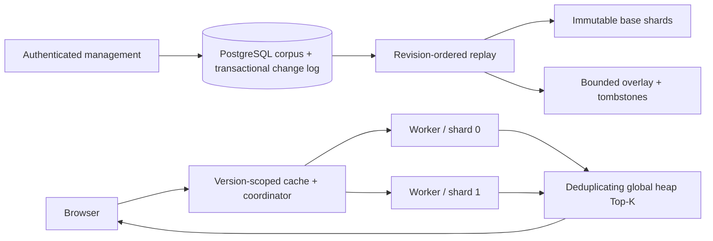

> Current optimization: compaction now exports through read-only REPEATABLE READ and builds/persists in one background task, then replays the tail before activation. Trigger 256, hard bound 1,024; current/history reads are nonblocking and RPC fan-out uses semaphore-bounded virtual threads. [Measured implementation and caveats](performance-optimization-2026-11-17.md) supersede earlier locking/thread-pool statements below.

# Snapshot-plus-delta and sharded serving



## Update ordering and recovery

V5 adds `index_update_events`. A suggestion-table trigger records full upsert metadata or a delete tombstone inside the same transaction as the authoritative change. Writers lock the global revision row before any suggestion write. `advance` increments the revision and records a COMMIT marker; ranking/restore operations record REBUILD instead. SQL tooling must obey the same lock/change/revision/marker contract. No Kafka delivery is needed for this baseline; PostgreSQL is the durable replay source.

Serving captures one immutable base plus a bounded delta. Compaction starts beyond 256 IDs or at 256 revisions; the in-flight hard limit is 1,024 IDs/revisions. Every changed ID suppresses its base representation, even if its display name, category, language, availability or shard ownership changed. Active replacement terms enter the bounded delta Trie; delete tombstones remain until compaction. `OverlayMap` resolves metadata against the same base/delta without copying the entire catalog on each update. A request retains one published snapshot reference throughout cache validation, ranking and response construction.

Consumers replay only complete consecutive revisions in deterministic revision/event-ID order. Already checkpointed duplicate or late events are ignored. Duplicate events within a revision overwrite the same delta ID idempotently. REBUILD markers, missing coverage and batches over 4,096 events cause a correctness-first rebuild. The soft 256 threshold schedules one background compaction; a 1,024 hard bound retains a synchronous fallback. Ranking policies are captured with the base, preventing live policy reads from changing scores mid-revision. A compactor captures a repeatable-read corpus and policy snapshot, ends its read transaction, then constructs and persists a candidate outside the serving monitor. Before activation it replays concurrent changes through the current revision, rejects gaps/rebuild markers/obsolete candidates, and atomically publishes equivalent current state; readers finish with their prior references. Compaction prunes whole revisions at the 100,000-row boundary (never a partial revision that could retain its COMMIT marker while losing changes); lagging consumers recover through a full rebuild.

Ordinary updates do **not** serialize the full corpus or rebuild the base Trie. They still rebuild small affected overlay indexes and copy bounded overlay/scope maps. Export is a read-only REPEATABLE READ transaction without a revision-row lock. Construction, serialization and artifact persistence do not hold that lock. Explicit administrative rebuilds remain synchronous within their process, but automatic compaction does not serialize mutation methods with construction. Checkpoint history now records explicit/automatic compactions, not every delta revision. The existing 20-checkpoint retention and policy-aware restore contract remain.

## Correct refill after tombstones

Filtering cached node Top-K alone is incorrect: deleted winners can hide lower valid terms, including another ID with the same normalized text. Base nodes retain sorted terminal entries. If a suppressed ID affects a cached winner, best-first traversal uses each node's best original candidate as a safe ranking upper bound and refills valid unique results. It stops once no unseen node can beat the current Kth result. Typical unaffected queries use precomputed candidates directly. Refill has a 50,000-work-item / soft 50ms budget; exhaustion returns 503 rather than an incorrect exact Top-K. This is CPU protection, not a hard real-time guarantee. Fuzzy retrieval remains bounded best effort and can underfill after exclusions/budget exhaustion.

## Partitioning and deterministic merge

`ShardedIndex` routes normalized display keys using `floorMod(normalizedKey.hashCode(), shardCount)` with Java's specified UTF-16 string hash. Normalization and shard count are part of the routing contract; the wire epoch is `normalized-hash-v1:<count>`. Display duplicates colocate. Inserts/renames may change ownership, handled by old-ID suppression plus routing the replacement into its new shard.

Each local shard returns at most K unique normalized display suggestions using the same tenant ranking weights and tie-breaks. Merge deduplicates by normalized display key, chooses the better candidate under that comparator and selects global K through a bounded min-heap. At most 32 lists of 40 entries are accepted by the merge helper; production fan-out is capped at 16 shards × 20 results. Arrival order never affects ordering. The merge costs O(S*K log K) after bounded deduplication. Local shard retrieval has a prefix-navigation fast path; deletion refill and fuzzy costs are separately bounded.

## Local and HTTP modes

- `index.shards` / `INDEX_SHARDS`: 1..16; default four.
- `index.shard-id=-1`: owns all local shards (default single-process demo).
- `index.shard-id=0..N-1`: worker owns only that partition's Trie/delta nodes. Direct public autocomplete is rejected to prevent returning a partial corpus.
- `index.shard-id=-2`: no local Trie partitions; coordinator retains metadata/ranking contracts for validation.
- `index.workers`: comma-separated worker origins in shard-ID order. Count must match the configured shard count.
- `index.internal-secret`: at least 32 characters; internal endpoint `/internal/shards/query` checks it with constant-time comparison. Internal tenant context is accepted only after this independent service credential check. Production must additionally use private networking/TLS/mTLS and secret rotation.

The coordinator uses virtual threads for blocking HTTP with semaphores limiting 64 requests and 128 active RPCs, per-worker HTTP timeout 180ms and an overall fan-out budget 200ms. There is no eight-thread queue. Missing, overloaded, stale, wrong-owner or wrong-epoch workers fail the request with 503; no silently partial exact Top-K is returned. Outstanding futures are cancelled. Every returned candidate is validated against the coordinator's captured tenant metadata and expected hash owner. Cache hits are still eligibility-checked and may serve complete valid results during a shard outage.

Workers hold at most 64 published revisions and serve historical entries only during their first three seconds. References are pruned on publication; an idle worker can retain expired references until its next update, still bounded by 64. Replay materializes each committed revision, so a newer worker can answer the coordinator's earlier captured revision. Current and retained-version lookups avoid the Corpus monitor; a behind worker catches up on demand through the serialized replay path. Revision history avoids the initial implementation's severe update-time version-mismatch failures while preserving single-version merges. Missing history, rebuild jumps, excessive update rates, and lag beyond the retained window can still cause 503. Each serving process confirms PostgreSQL freshness; a stale process fails closed after three seconds. No replica failover or live shard reassignment registry is implemented.

Version-scoped single-flight coalesces concurrent cache misses using at most 128 pending keys. Waiters have a 250ms bound; the owner follows its underlying cache/fan-out bounds. Completed results are not retained by single-flight. Redis population runs on two dedicated workers with at most 256 queued writes; saturation drops optional writes and increments a metric. Cache population never extends query latency and old-version writes cannot become new-version results. Keys already contain authenticated tenant/context/version scope. Fuzzy candidate results are not stored as exact-cache entries.

Workers own only their Trie partitions, but all processes still retain the full bounded metadata catalog and read the same database. This is working multi-process sharded retrieval, not a 100-million-term deployment architecture. Snapshot distribution via S3, partition-owned metadata stores, replica ownership leases and a control-plane registry remain future work. The local corpus cap stays 100,000.

## Run

```sh
cd search-autocomplete-platform
docker compose -f compose.yml -f compose.shards.yml up --build
```

The override runs one metadata coordinator and two private shard workers alongside PostgreSQL/Redis/frontend. It is provided for reproducibility; load measurements used equivalent separate local JVMs as documented in the load-test README. No AWS or live Kubernetes deployment was executed.
